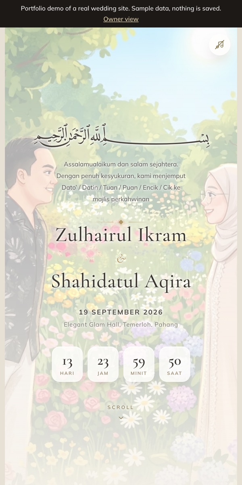

# mytetamu.my

A mobile wedding invitation site I planned and shipped for my own wedding. It takes RSVPs and answers guests' travel questions so they don't have to message us.

**Try the demo:** [demo link goes here] (sample data, nothing you do is saved)



In the demo the countdown is shifted two weeks ahead, so you see the site as guests did before the wedding.

## The problem

Our wedding was a night event in Temerloh, Pahang. Most guests live in or around Kuala Lumpur, a 1.5 to 2 hour drive away, with the drive home after dark. A normal invite gives the date and the venue. It doesn't answer the questions guests actually send the couple: how do I get there, where can I stay the night, what is there to do nearby, and what gift should I bring.

Almost every guest opened the invite from a WhatsApp link on their phone, so I designed it for one thumb on a small screen.

## Who it's for

The same page serves two kinds of guests:

- **Skimmers** want the date, time, place and RSVP, then they're gone. All of that sits at the top.
- **Planners** want the route, a place to stay and things to do. That's further down.

There's a third user: the two of us. We needed to see RSVPs and manage the gift list without opening a database.

## What it does

- RSVP form that records how many people are coming and whether they're staying overnight
- Directions that open in Waze or Google Maps with one tap, plus a button to save the date to your calendar
- A short list of nearby hotels and homestays, and local places to visit
- A gift registry on a separate link for close family and friends. Guests reserve a gift so two people don't buy the same thing. There's also a QR code for cash gifts.
- A wall where guests leave wishes for the couple
- A password-protected admin page where we see RSVPs, edit the gift list and moderate wishes
- An animated invite page with music, made for sharing

## Results

- **260 guests** confirmed through 82 RSVPs, between 4 August and the wedding day on 19 September 2026
- **Two thirds of those guests (174)** said they'd stay the night in Pahang. That backed the bet in the original plan: helping guests with the trip mattered as much as the invite itself.

## How I worked

I wrote a [product requirements doc](wedding-landing-page-prd.md) before building anything, then ran a [persona-based UX review](IMPROVEMENTS.md) and fixed the issues it found. Bigger changes went to a preview link that I checked on a real phone before they went live. My wife, Aqira, redesigned the gift registry page through pull requests that I reviewed and merged. I wrote the code with AI coding assistants (Claude Code and Codex). The product decisions were mine.

## Tech stack

- **Astro** builds the pages ahead of time, so they load fast on mobile data
- **Tailwind CSS** for styling
- **Supabase** (a hosted Postgres database) stores RSVPs, gifts and wishes. Access rules stop guests from reading each other's details.
- **Vercel** hosts the site. Merging to the main branch publishes it.
- **GSAP** for the animation on the invite page

## Run it locally

You need [Node.js](https://nodejs.org) 22.12 or newer.

```bash
npm install
cp .env.example .env
npm run dev
```

Then open http://localhost:4321.

Your `.env` needs `PUBLIC_PORTFOLIO_MODE=true`. The `.env.example` in the public repo already sets it, so the site runs on sample data inside your browser. There's no database or account to set up, and nothing you do is saved. The demo banner at the top links between the pages. Try the RSVP form on the invite, reserve a gift on the "Gift registry" page, and watch the "Animated invite". Then tap "Owner view", in the same tab, and the password `demo-password-2026` opens the couple's board. Your changes last until you close the tab.

The code can also run against a real Supabase database, but that setup isn't covered here.

## Credits

Music in the demo: Chopin, Nocturne in E-flat major, Op. 9 No. 2, performed by Frank Lévy, from Musopen's Set Chopin Free project. Public domain; credited as a courtesy. Source: https://commons.wikimedia.org/wiki/File:Chopin_-_Nocturne_No._2_in_E-flat_major,_Op._9_No._2_(Frank_Levy).flac

Photos of places, stays and gifts belong to their owners and are shown for illustration only.

## What I'd build next

- **A "my gifts" view.** Today a guest who switches phones can't see what they already reserved, so the only way to check is to reserve again. This view would show them.
- **Photo upload in the admin page,** so we could add gift pictures without a developer.
- **A template other couples can reuse.** Most of the content already sits in one settings file and a few database tables, so the next step is a simple setup flow for names, date and venue.
